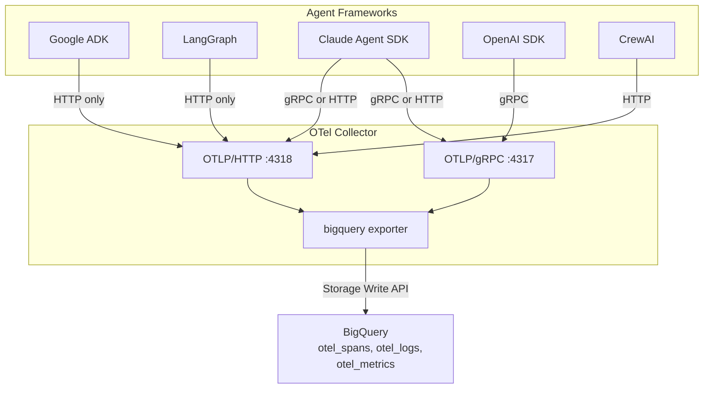

# Deployment Models

The BigQuery OTel Exporter is an OpenTelemetry Collector component. Every
deployment model involves running a Collector process that receives OTLP
telemetry and writes it to BigQuery. This document covers the four models,
their tradeoffs, and authentication options.

## Overview



## Model A: Sidecar Collector

Each pod runs a Collector alongside the application. The Collector binds a
loopback address so only the pod's application can reach it.

**Pros:**
- No network hop — telemetry stays in the pod.
- Simple isolation: one Collector per application.
- No shared failure domain.

**Cons:**
- One Collector per pod increases resource overhead.
- No central processing or filtering before BigQuery.

**Best for:** Single-node Kubernetes, development, and applications with
strict data-locality requirements.

**Template:** `deploy/helm/bigquery-otel-collector/` with `replicaCount: 1`
or as a DaemonSet.

## Model B: Collector Gateway / DaemonSet

A pool of Collector pods behind a Kubernetes Service. Applications send
telemetry to the Service, which load-balances across Collector instances.

**Pros:**
- Central PII redaction, sampling, and attribute filtering before BigQuery.
- Fewer Collector instances (shared pool).
- Horizontal scaling under load.

**Cons:**
- Network hop from application to gateway.
- Shared failure domain (a gateway outage affects all producers).

**Best for:** Production multi-node clusters, centralized telemetry pipelines.

**Template:** `deploy/helm/bigquery-otel-collector/` with `replicaCount: N`.

## Model C: Cloud Run

The Collector runs as a Cloud Run service. Applications send OTLP over HTTP
(the only option for some frameworks) to the Cloud Run endpoint.

**Pros:**
- No Kubernetes to manage.
- Auto-scaling to zero when idle.
- Pay-per-use (no idle cost).

**Cons:**
- Stateless — no persistent queue for crash-replay.
- Cold start latency for the first request.
- gRPC support depends on the Cloud Run revision (HTTP is always available).

**Best for:** Serverless deployments, bursty workloads, teams without
Kubernetes expertise.

**Template:** `deploy/cloudrun/service.yaml`

## Model D: Docker Compose

Single-host deployment using Docker Compose. The collector runs in a
hardened container with read-only filesystem, dropped capabilities, and
no-new-privileges.

**Best for:** Development, testing, and single-host production.

**Template:** `example/docker-compose.yml`

## Authentication

All models authenticate to BigQuery using one of:

| Method | Config | Best for |
|:---|:---|:---|
| **Application Default Credentials** | Default (no config) | GCE, GKE, Cloud Run, Cloud Build |
| **Service Account Key File** | `credentials.file` or `GOOGLE_APPLICATION_CREDENTIALS` | On-prem, any cloud, development |
| **Workload Identity Federation** | `credentials.impersonate_service_account` | GKE with IAM Conditions |
| **Service Account Impersonation** | `credentials.impersonate_service_account` | Cross-project, least-privilege |
| **No Authentication (loopback)** | `endpoint.without_authentication: true` | Emulators, local testing |

### Workload Identity Federation (GKE)

1. Create a GCP service account with the least-privilege IAM role from
   `deploy/terraform/`.
2. Create a Kubernetes ServiceAccount and annotate it:
   ```yaml
   serviceAccount:
     create: true
     annotations:
       iam.gke.io/gcp-service-account: "otel-collector@my-project.iam.gserviceaccount.com"
   ```
3. Bind the Kubernetes ServiceAccount to the GCP service account with an
   IAM policy binding.

## Transport Requirements

Both OTLP/gRPC (port 4317) and OTLP/HTTP (port 4318) must be available.
Some agent frameworks only support HTTP:

| Framework | gRPC | HTTP |
|:---|:---|:---|
| Google ADK | — | Only option |
| LangGraph | — | Only option |
| Claude Agent SDK | Supported | Supported |
| OpenAI SDK | Supported | Supported |
| CrewAI | — | Only option |

The example config and Helm chart listen on both ports by default.

## Security Hardening

All deployment templates apply:

- `runAsNonRoot: true` / `readOnlyRootFilesystem: true`
- `cap_drop: [ALL]` / `no-new-privileges: true`
- `tmpfs: [/tmp]` for writable scratch space
- Bind to loopback where applicable (Docker Compose, sidecar)
- Health check on port 13133 for liveness/readiness probes

## Enterprise Features

All deployment templates support the full signal set and enterprise
governance options. The configuration blocks below are opt-in; each defaults
to a safe value when omitted.

### Signal Pipelines

The collector exports **traces**, **logs**, and **metrics** pipelines to
BigQuery. The `metrics` pipeline writes to `otel_metrics` (all five OTLP
metric data-point types in a single relational table) and is wired by default
in the Helm chart, Cloud Run image, and example config. Disable it by
removing the `metrics:` entry from `service.pipelines`.

### GCS Offload

Large prompts, completions, and multimodal payloads can be offloaded to Google
Cloud Storage and referenced from BigQuery `payload_refs` via `ObjectRef`:

```yaml
offload:
  enabled: true
  bucket: my-otel-offload-bucket
  prefix: otel
  min_bytes: 1048576
  max_object_bytes: 67108864
  max_concurrency: 4
  timeout: 30s
  cache_size: 4096
```

`cache_size` bounds a cross-batch LRU cache that deduplicates offload attempts
for the same payload across batches, avoiding redundant GCS uploads. The
exporter does not delete offloaded objects; configure a [GCS lifecycle
policy](https://cloud.google.com/storage/docs/lifecycle) to manage retention.
A `401`/`403`/`404` on GCS upload is classified as a permanent error and
routes the record to quarantine instead of triggering retries.

### Quarantine and Replay

Rejected records (validation failures, structural limit breaches, oversized
rows, permanent offload errors) can be routed to a dead-letter table:

```yaml
quarantine:
  enabled: true
  table: otel_quarantine
  metadata_only: false
  partition_expiration_days: 30
```

Use `cmd/bq-quarantine-replay` to replay quarantined records after fixing the
underlying issue:

```bash
go run ./cmd/bq-quarantine-replay \
  --input=quarantine.jsonl \
  --signal=spans,logs \
  --error-code=OVERSIZE_ROW
```

### Redaction

Client-side PII and secret redaction runs at Step 0, before offload,
fingerprinting, and quarantine:

```yaml
redaction:
  enabled: true
  blocked_keys: ["x-custom-secret"]
  disable_default_keys: false
  blocked_value_patterns: ["Bearer [A-Za-z0-9._-]+"]
  mask_replacement: "[REDACTED]"
  redact_log_body: false
```

Default sensitive keys (`authorization`, `token`, `password`, `api_key`,
`secret`, `private_key`, etc.) are redacted unless `disable_default_keys` is
true.

### CMEK Encryption and Labels

Enterprise customers can configure CMEK encryption and labels for cost
allocation and governance:

```yaml
kms_key_name: projects/my-project/locations/us-central1/keyRings/otel/cryptoKeys/bq
labels:
  environment: production
  team: observability
```

The Terraform module (`deploy/terraform/`) provisions CMEK on the dataset and
all tables when `kms_key_name` is set, and grants the BigQuery encryption
service agent `roles/cloudkms.cryptoKeyEncrypterDecrypter` on the KMS key. Labels
are applied to the dataset, all tables, and all views.

### Search Indexes

Trace-lookup search indexes on `(trace_id, span_id)` for `otel_spans` and
`otel_logs`, and all-columns indexes on `otel_metrics`, can be created at
startup:

```yaml
auto_create:
  tables: true
  companion_views: true
  search_indexes: true
```

`search_indexes` requires `auto_create.tables` and `bigquery.jobs.create` (the
Terraform module grants this when `grant_auto_create` is set).

